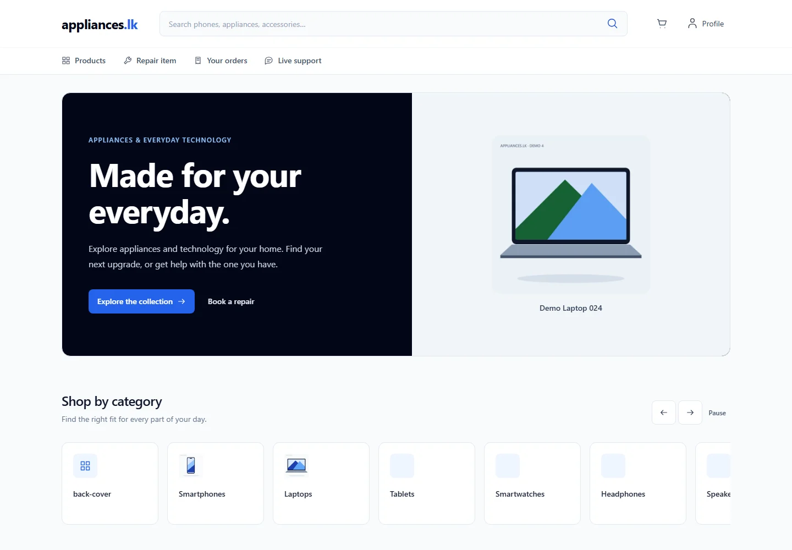
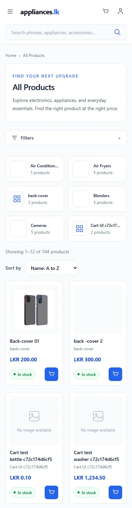
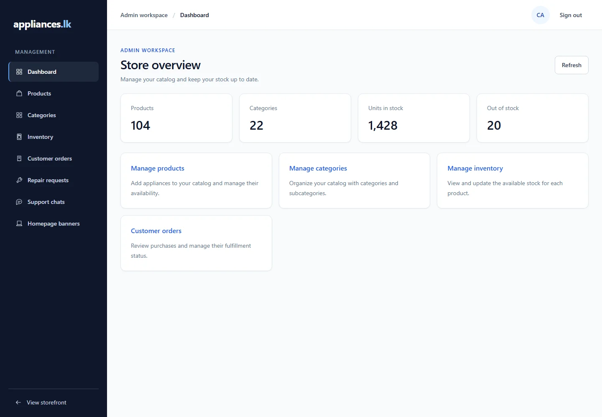
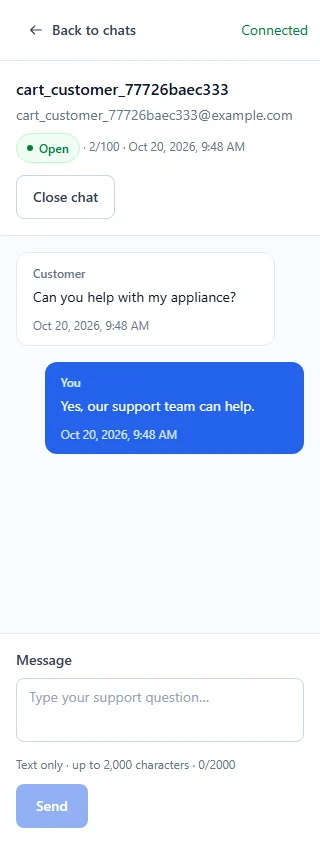

# Appliances.lk frontend design system

This revamp covers the existing public, customer, admin and repairer workspaces. It retains the routes, services, authentication, API payloads, payment verification, catalog filtering, reviews, repair actions, AI assistant and live chat contracts.

## Visual foundation

`src/index.css` defines the Tailwind theme: deep blue actions, navy workspaces, white surfaces, slate backgrounds, semantic feedback colors, one font stack and restrained shadows. It also contains keyboard focus, long-text wrapping, reduced-motion and basic input rules. Inter is used when available, with a system sans-serif fallback; no remote font request or new asset dependency was added.

`src/App.css` defines shared component classes, including buttons, fields, cards, badges, states, tooltips, dialogs and responsive tables. Existing `auth-*` classes remain compatible so the same visual rules apply to established forms. Buttons have practical 44px default targets; smaller status indicators are not interactive controls.

## Shared components

| Component                                          | Responsibility                                                                                             |
| -------------------------------------------------- | ---------------------------------------------------------------------------------------------------------- |
| `components/ui/Button.tsx`                         | Primary, secondary, ghost and danger actions; disabled and busy states                                     |
| `components/ui/StatusBadge.tsx`                    | One mapping from business statuses to semantic color and visible text                                      |
| `components/ui/Feedback.tsx`                       | Shared spinner, skeleton, loading, error, empty and alert patterns                                         |
| `components/ui/Dialog.tsx`                         | Native modal dialog/drawer, keyboard dismissal, focus restoration, body scroll locking and busy protection |
| `components/ui/Tooltip.tsx`                        | Keyboard and pointer tooltip with an accessible description                                                |
| `components/ui/OrderProgress.tsx`                  | Current order stage, without inventing historical dates                                                    |
| `components/chat/*`                                | Shared support session and conversation presentation                                                       |
| `pages/Products/components/CatalogProductCard.tsx` | Consistent home/catalog product presentation with real prices, availability and ratings                    |

Status semantics: paid/delivered/completed/approved/in-stock/open are green; pending/processing/waiting are amber; active/in-progress/shipped/confirmed are informational; failed/rejected/cancelled/out-of-stock are red; assignment and collection stages use indigo. Neutral and closed states use slate. Text accompanies the color.

New shared copy is in `utils/uiText.ts`; established feature copy remains in its existing translation/text files. Existing icons are reused without a new icon library. Product image fallback and `object-contain` behavior are preserved.

Repair timestamps now use the existing `utils/date.ts` formatter, including its Asia/Colombo timezone. Purchase dates remain calendar dates. `ChatPane` supplies a full-height native mobile conversation view, focus isolation, viewport/keyboard resizing and a persistent composer. Unsent text survives crossing the desktop/mobile breakpoint, while confirmation state is scoped to the selected conversation.

## Workspace changes

- The storefront uses a compact mobile header, accessible search/cart/account controls, a navigation drawer, a restrained desktop navigation bar and a footer with support links instead of placeholder contact information.
- The home fallback hero uses an actual catalog product, followed by categories, shared product cards, repair access and the existing factual benefits. Configured promotional banners still take precedence. No ratings, discounts, testimonials, delivery promises or analytics were invented.
- Catalog filters use a mobile drawer and a desktop sidebar. Filter instances use unique field IDs. Sorting, query parameters, result counts and pagination keep their existing behavior.
- Authentication keeps its controlled forms and validation, with a compact mobile form and a navy desktop brand panel.
- Customer purchasing and tracking pages share form controls, panels, states and semantic badges. Order details include the actual current order stage.
- Admin uses a fixed navy desktop sidebar, workspace header and a drawer on smaller screens. Products, categories, orders and repairs use labeled row cards below 1280px; desktop tables retain their data and actions. Existing dashboards show real catalog counts.
- Repairer pages share the typography, panels, controls, status system and responsive rows. The placeholder statistics card was removed. Status updates use an accessible confirmation dialog.
- Live chat uses separate mobile session/conversation views with a back action, message counts and a reachable composer. Returning to sessions leaves the active room so incoming replies remain unread. Admin chat closure has a confirmation. Socket contracts and persistence are unchanged.
- The product assistant uses the same navy/blue surfaces, prompt controls, feedback and message styling. It remains separate from human support chat.
- Review deletion, repair review and order cancellation use explicit confirmations. Cancellation copy states that cancelling an order does not refund a payment.

There is no frontend notifications inbox in the current project. Existing email notifications remain a backend integration; this change does not add a fictional notifications page.

## Page review inventory

The repeatable review uses the existing API and generated fixtures for all 30 routes, at 320, 375, 390, 430, 768, 1024 and 1440px (210 combinations). It captures screenshots, checks document overflow and JavaScript errors, and exercises navigation dismissal. Detail IDs below are replaced with fixture IDs.

| Workspace       | Routes                                                                                                                                                                                                                                  |
| --------------- | --------------------------------------------------------------------------------------------------------------------------------------------------------------------------------------------------------------------------------------- |
| Public/auth — 7 | `/`, `/products`, `/products/:id`, `/login`, `/register`, `/forbidden`, unknown path                                                                                                                                                    |
| Customer — 9    | `/cart`, `/checkout`, `/orders`, `/orders/:id`, `/repairs`, `/repairs/request`, `/repairs/:id`, `/account`, `/support/chat`                                                                                                             |
| Admin — 11      | `/admin`, `/admin/products` (includes create form), `/admin/products/:id/edit`, `/admin/categories`, `/admin/inventory`, `/admin/orders`, `/admin/orders/:id`, `/admin/repairs`, `/admin/repairs/:id`, `/admin/banners`, `/admin/chats` |
| Repairer — 3    | `/repairer`, `/repairer/repairs`, `/repairer/repairs/:id`                                                                                                                                                                               |

Additional review covers the fallback hero, mobile filters, AI panel, admin approval/rejection dialog and repairer status update. Existing feature suites cover catalog queries, file upload, reviews, cart mutations, checkout/PayHere verification, order tracking, admin fulfilment and live chat in desktop/mobile browsers.

## Running verification

Use a local migrated PostgreSQL database and build the backend first. The existing browser test helper runs a separate API on port 3001 and Vite on 5174. It now uses the existing email mock, preventing browser tests from calling SMTP. Production email and authentication code are unchanged.

```powershell
# From frontend
npm run build
npm run lint
npm run test:ui:e2e
npm run test:ui:regression
npm run test:ui:chat
npm run test:ai:e2e
```

The regression runner starts each established suite independently so the real login limiter remains enabled. It does not disable authentication security to accommodate a large test batch. For a focused layout check, set `UI_REVIEW_ROLES` (comma-separated public/customer/admin/repairer) and/or `UI_REVIEW_WIDTHS`, then run the layout test. Omit those variables for the complete matrix. Screenshots are generated under `test-results/`.

Browser viewport checks cover responsive layout and interaction; they do not simulate every physical device keyboard or constitute a formal accessibility certification. Dynamic copy and imagery from the configured catalog/banners remain store-managed content.

## Verification and previews — 20 October 2026

- Production build and full frontend ESLint pass.
- All 52 existing helper tests pass.
- All eight feature browser suites pass across desktop and mobile (64 cases); the AI widget's six additional browser cases also pass.
- The complete 30-route, seven-width matrix passes all 210 combinations, including no document overflow and no uncaught JavaScript errors.
- Chat also passes its complete flow at all seven widths, including unread state, resizing, draft preservation, nested confirmation dismissal and a reduced 500px viewport height with the send action visible.
- Focused checks confirm responsive table labels/actions, repair approval and repairer status updates, file uploads and order management after the final layout changes.

Vite retains its existing advisory about the main bundle exceeding 500 kB. This revamp adds no runtime dependencies or remote fonts.

These previews use development catalog data and generated test accounts. Store-managed products and banners were preserved.

| Storefront | Catalog on mobile |
| --- | --- |
|  |  |

| Admin workspace | Mobile support conversation |
| --- | --- |
|  |  |
